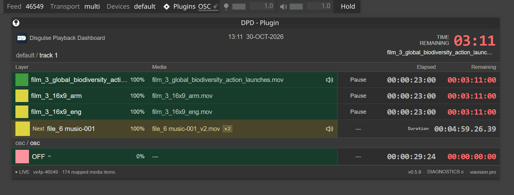
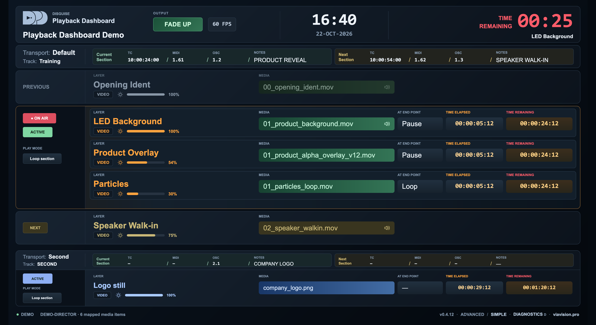
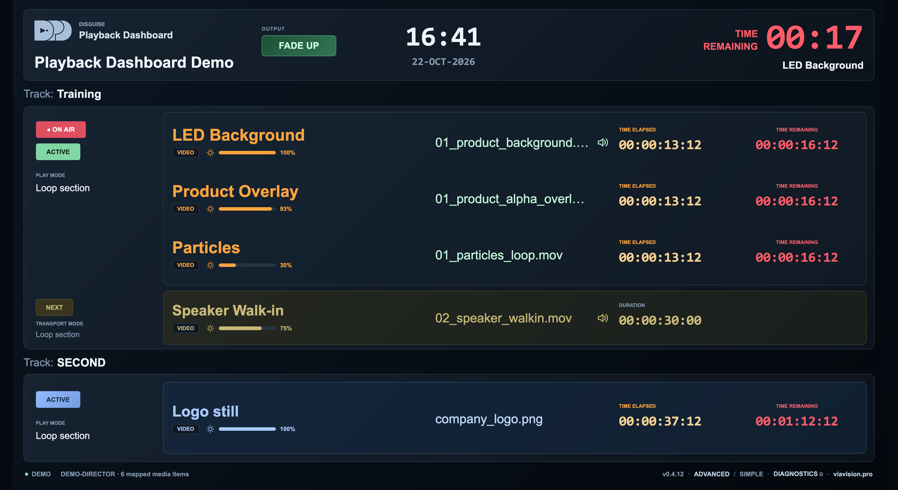

# Disguise Playback Dashboard

[Русский](README_RU.md)

**DPD** is a native playback dashboard plugin for **Disguise Designer**.
It runs from the project's Plugins folder and connects automatically. No settings
file edits, additional runtime installation or separate server are required.

## Views

**Compact** opens inside **Designer GUI**. It shows the main and secondary
transports, active layers, upcoming media, elapsed and remaining time. Layer
colour markers follow Designer's **Layer Colour Rules**, including track rules.
The secondary transport row is hidden when only one transport exists.

**Advanced** and **Simple** open in a **browser** through Designer's web interface.
Advanced adds Previous / Active / Next, section metadata and Director FPS.
Simple focuses on Active / Next and larger timers.

## Installation

1. Download **DPD_v0.5.10_Plugin.zip** from [Releases](https://github.com/viavisionpro/DPD-Disguise-Playback-Dashboard/releases/latest).
2. Extract the **DPD-0.5.10** folder into your project's **Plugins** folder. When
   updating, close DPD and remove its previous folder from Plugins first.
3. Open the project and choose **DPD - Plugin** from Designer's **Plugins** menu.

With multiple transports, choose the main one on first launch. The project
remembers the selection. Press **D** or click **DIAGNOSTICS** to change it later.

For browser access, open the **Director's IP address**, then select DPD in the
Designer web interface. Advanced opens by default; use the footer to switch
between Advanced and Simple. Devices must have access to the Director's network.

Targets **Designer r31+**; window size and layer colours confirmed on **r33.2.4**.
Diagnostics opens within the current page. Designer still permits height resizing.
DPD monitors playback without controlling it; transport preferences are saved in
the project. Video and Generative layers are displayed; timing for stills and
generative content is approximate. The speaker marks an embedded audio track.

## License

[GPLv3 only](LICENSE) · Copyright © 2026 Vladimir Zakharov · [viavision.pro](https://viavision.pro)

Plugin source is in `plugin/`; Vue source and its development build configuration
are in `plugin/frontend/`. Development tools are not required on Designer.
